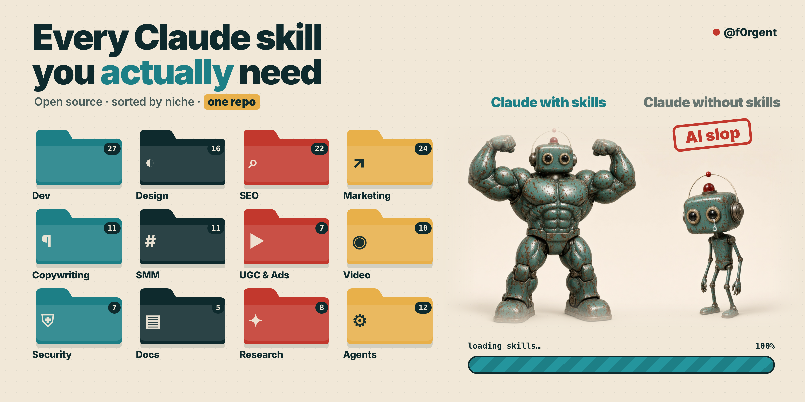

<p align="center"></p>

<p align="center">
  
  
  
  
  
  <a href="https://x.com/f0rgent"></a>
</p>

<p align="center"><a href="#s1">Dev workflow</a> · <a href="#s2">Dev stacks</a> · <a href="#s3">Security</a> · <a href="#s4">Design</a> · <a href="#s5">SEO</a> · <a href="#s6">Marketing</a> · <a href="#s7">Copywriting</a> · <a href="#s8">SMM</a> · <a href="#s9">UGC & Ads</a> · <a href="#s10">Video</a> · <a href="#s11">Docs</a> · <a href="#s12">Product</a> · <a href="#s13">Research</a> · <a href="#s14">AI agents</a></p>

<p align="center"><b>The best open-source skills for Claude Code, sorted by what you do.</b><br>Every skill links to its original author, so you always get the latest version.<br>The list keeps growing. ⭐ Star the repo to get updates.</p>

## ⚡ Install in 10 seconds

```bash
# one skill
npx skills@latest add coreyhaines31/marketingskills/copywriting

# everything in this catalog (pulls each repo from its author)
git clone --recursive https://github.com/f0rgent/claude-skills-catalog
```

<a id="s0"></a>
## 🏆 Start here: top 10

If you install nothing else, install these.

| # | Skill | What it does | Repo | ⭐ |
|---|---|---|---|---|
| 1 | [**frontend-design**](https://github.com/anthropics/skills/tree/main/skills/frontend-design) | Picks a visual direction before coding UI, so pages stop looking like AI defaults | [anthropics/skills](https://github.com/anthropics/skills) | 187k |
| 2 | [**superpowers**](https://github.com/obra/superpowers) | Full dev workflow: brainstorm, plan, TDD, review, subagents | [obra/superpowers](https://github.com/obra/superpowers) | 312k |
| 3 | [**skill-creator**](https://github.com/anthropics/skills/tree/main/skills/skill-creator) | Builds and tests your own skills | [anthropics/skills](https://github.com/anthropics/skills) | 187k |
| 4 | [**karpathy-guidelines**](https://github.com/forrestchang/andrej-karpathy-skills) | Rules that cut the typical LLM coding mistakes | [forrestchang/andrej-karpathy-skills](https://github.com/forrestchang/andrej-karpathy-skills) | 229k |
| 5 | [**ui-ux-pro-max**](https://github.com/nextlevelbuilder/ui-ux-pro-max-skill/tree/main/.claude/skills/ui-ux-pro-max) | UI/UX design intelligence for web, mobile and desktop | [nextlevelbuilder/ui-ux-pro-max-skill](https://github.com/nextlevelbuilder/ui-ux-pro-max-skill) | 145k |
| 6 | [**web-design-guidelines**](https://github.com/vercel-labs/agent-skills/tree/main/skills/web-design-guidelines) | Audits UI code for accessibility and interface best practice | [vercel-labs/agent-skills](https://github.com/vercel-labs/agent-skills) | 34k |
| 7 | [**copywriting**](https://github.com/coreyhaines31/marketingskills/tree/main/skills/copywriting) | Writes and rewrites copy for landing, pricing and product pages | [coreyhaines31/marketingskills](https://github.com/coreyhaines31/marketingskills) | 58k |
| 8 | [**seo**](https://github.com/agricidaniel/claude-seo/tree/main/skills/seo) | Full SEO analysis: site audit, page, technical, Core Web Vitals | [agricidaniel/claude-seo](https://github.com/agricidaniel/claude-seo) | 26k |
| 9 | [**grill-me**](https://github.com/mattpocock/skills/tree/main/skills/productivity/grill-me) | Interrogates your plan until the holes show | [mattpocock/skills](https://github.com/mattpocock/skills) | 312k |
| 10 | [**obsidian-markdown**](https://github.com/kepano/obsidian-skills) | Lets the agent read and write your Obsidian vault properly | [kepano/obsidian-skills](https://github.com/kepano/obsidian-skills) | 51k |

## 🗂 Browse by niche

<table>
<tr>
<td align="center" width="25%"><a href="#s1"><h1>💻</h1><b>Dev workflow</b></a><br><sub>27 picks</sub></td>
<td align="center" width="25%"><a href="#s2"><h1>🧩</h1><b>Dev stacks</b></a><br><sub>23 picks</sub></td>
<td align="center" width="25%"><a href="#s3"><h1>🛡️</h1><b>Security</b></a><br><sub>7 picks</sub></td>
<td align="center" width="25%"><a href="#s4"><h1>🎨</h1><b>Design</b></a><br><sub>16 picks</sub></td>
</tr>
<tr>
<td align="center" width="25%"><a href="#s5"><h1>🔎</h1><b>SEO</b></a><br><sub>22 picks</sub></td>
<td align="center" width="25%"><a href="#s6"><h1>📈</h1><b>Marketing</b></a><br><sub>24 picks</sub></td>
<td align="center" width="25%"><a href="#s7"><h1>✍️</h1><b>Copywriting</b></a><br><sub>11 picks</sub></td>
<td align="center" width="25%"><a href="#s8"><h1>📱</h1><b>SMM</b></a><br><sub>11 picks</sub></td>
</tr>
<tr>
<td align="center" width="25%"><a href="#s9"><h1>🎯</h1><b>UGC & Ads</b></a><br><sub>7 picks</sub></td>
<td align="center" width="25%"><a href="#s10"><h1>🎬</h1><b>Video</b></a><br><sub>10 picks</sub></td>
<td align="center" width="25%"><a href="#s11"><h1>📄</h1><b>Docs</b></a><br><sub>5 picks</sub></td>
<td align="center" width="25%"><a href="#s12"><h1>🚀</h1><b>Product</b></a><br><sub>10 picks</sub></td>
</tr>
<tr>
<td align="center" width="25%"><a href="#s13"><h1>🧠</h1><b>Research</b></a><br><sub>8 picks</sub></td>
<td align="center" width="25%"><a href="#s14"><h1>🤖</h1><b>AI agents</b></a><br><sub>12 picks</sub></td>
</tr>
</table>

<a id="s1"></a>
## 💻 Developers: workflow

How the agent plans, codes, reviews and ships.

| Skill | What it does | Repo |
|---|---|---|
| [**brainstorming**](https://github.com/obra/superpowers/tree/main/skills/brainstorming) | Forces a design conversation before any new feature | [obra/superpowers](https://github.com/obra/superpowers) |
| [**writing-plans**](https://github.com/obra/superpowers/tree/main/skills/writing-plans) | Turns a spec into a step-by-step implementation plan | [obra/superpowers](https://github.com/obra/superpowers) |
| [**executing-plans**](https://github.com/obra/superpowers/tree/main/skills/executing-plans) | Works through a plan inline, step by step | [obra/superpowers](https://github.com/obra/superpowers) |

<details><summary><b>Show all 27 dev workflow skills</b></summary>

| Skill | What it does | Repo |
|---|---|---|
| [**subagent-driven-development**](https://github.com/obra/superpowers/tree/main/skills/subagent-driven-development) | Runs plan tasks through separate subagents | [obra/superpowers](https://github.com/obra/superpowers) |
| [**dispatching-parallel-agents**](https://github.com/obra/superpowers/tree/main/skills/dispatching-parallel-agents) | Splits independent tasks across agents in parallel | [obra/superpowers](https://github.com/obra/superpowers) |
| [**test-driven-development**](https://github.com/obra/superpowers/tree/main/skills/test-driven-development) | Red-green-refactor before writing implementation | [obra/superpowers](https://github.com/obra/superpowers) |
| [**systematic-debugging**](https://github.com/obra/superpowers/tree/main/skills/systematic-debugging) | Root-cause debugging instead of guess-and-check | [obra/superpowers](https://github.com/obra/superpowers) |
| [**verification-before-completion**](https://github.com/obra/superpowers/tree/main/skills/verification-before-completion) | Makes the agent prove tests pass before saying done | [obra/superpowers](https://github.com/obra/superpowers) |
| [**requesting-code-review**](https://github.com/obra/superpowers/tree/main/skills/requesting-code-review) | Self-review against requirements before merge | [obra/superpowers](https://github.com/obra/superpowers) |
| [**receiving-code-review**](https://github.com/obra/superpowers/tree/main/skills/receiving-code-review) | Handles review feedback with rigor, not blind agreement | [obra/superpowers](https://github.com/obra/superpowers) |
| [**using-git-worktrees**](https://github.com/obra/superpowers/tree/main/skills/using-git-worktrees) | Isolated workspace per feature | [obra/superpowers](https://github.com/obra/superpowers) |
| [**finishing-a-development-branch**](https://github.com/obra/superpowers/tree/main/skills/finishing-a-development-branch) | Decides how to merge finished work | [obra/superpowers](https://github.com/obra/superpowers) |
| [**code-review**](https://github.com/mattpocock/skills/tree/main/skills/engineering/code-review) | Reviews a diff against repo standards and spec | [mattpocock/skills](https://github.com/mattpocock/skills) |
| [**diagnosing-bugs**](https://github.com/mattpocock/skills/tree/main/skills/engineering/diagnosing-bugs) | Diagnosis loop for hard bugs and slowdowns | [mattpocock/skills](https://github.com/mattpocock/skills) |
| [**tdd**](https://github.com/mattpocock/skills/tree/main/skills/engineering/tdd) | Test-first features and fixes | [mattpocock/skills](https://github.com/mattpocock/skills) |
| [**to-spec**](https://github.com/mattpocock/skills/tree/main/skills/engineering/to-spec) | Turns the chat into a spec in your issue tracker | [mattpocock/skills](https://github.com/mattpocock/skills) |
| [**to-tickets**](https://github.com/mattpocock/skills/tree/main/skills/engineering/to-tickets) | Breaks a spec into tracer-bullet tickets | [mattpocock/skills](https://github.com/mattpocock/skills) |
| [**implement**](https://github.com/mattpocock/skills/tree/main/skills/engineering/implement) | Implements work from a spec or tickets | [mattpocock/skills](https://github.com/mattpocock/skills) |
| [**improve-codebase-architecture**](https://github.com/mattpocock/skills/tree/main/skills/engineering/improve-codebase-architecture) | Finds refactor opportunities, shows an HTML report | [mattpocock/skills](https://github.com/mattpocock/skills) |
| [**prototype**](https://github.com/mattpocock/skills/tree/main/skills/engineering/prototype) | Throwaway prototype to answer a design question | [mattpocock/skills](https://github.com/mattpocock/skills) |
| [**pr**](https://github.com/mattpocock/skills/tree/main/skills/engineering/pr) | Writes the PR description | [mattpocock/skills](https://github.com/mattpocock/skills) |
| [**git-guardrails-claude-code**](https://github.com/mattpocock/skills/tree/main/skills/misc/git-guardrails-claude-code) | Blocks dangerous git commands via hooks | [mattpocock/skills](https://github.com/mattpocock/skills) |
| [**setup-pre-commit**](https://github.com/mattpocock/skills/tree/main/skills/misc/setup-pre-commit) | Husky + lint-staged + type check + tests | [mattpocock/skills](https://github.com/mattpocock/skills) |
| [**handoff**](https://github.com/mattpocock/skills/tree/main/skills/productivity/handoff) | Compacts a session into a handoff doc for another agent | [mattpocock/skills](https://github.com/mattpocock/skills) |
| [**simplify**](https://github.com/anthropics/skills) | Cleans up changed code (built into Claude Code) | [anthropics/skills](https://github.com/anthropics/skills) |
| [**webapp-testing**](https://github.com/anthropics/skills/tree/main/skills/webapp-testing) | Tests local web apps with Playwright | [anthropics/skills](https://github.com/anthropics/skills) |
| [**mcp-builder**](https://github.com/anthropics/skills/tree/main/skills/mcp-builder) | Builds MCP servers the right way | [anthropics/skills](https://github.com/anthropics/skills) |

</details>

<p align="right"><a href="#s0">↑ top</a></p>

<a id="s2"></a>
## 🧩 Developers: languages, frameworks, infra

Specialist skills per stack.

| Skill | What it does | Repo |
|---|---|---|
| [**react-best-practices**](https://github.com/vercel-labs/agent-skills/tree/main/skills/react-best-practices) | Vercel's React and Next.js performance rules | [vercel-labs/agent-skills](https://github.com/vercel-labs/agent-skills) |
| [**composition-patterns**](https://github.com/vercel-labs/agent-skills/tree/main/skills/composition-patterns) | React composition patterns that scale | [vercel-labs/agent-skills](https://github.com/vercel-labs/agent-skills) |
| [**react-native-skills**](https://github.com/vercel-labs/agent-skills/tree/main/skills/react-native-skills) | React Native and Expo best practices | [vercel-labs/agent-skills](https://github.com/vercel-labs/agent-skills) |

<details><summary><b>Show all 23 dev stacks skills</b></summary>

| Skill | What it does | Repo |
|---|---|---|
| [**react-view-transitions**](https://github.com/vercel-labs/agent-skills/tree/main/skills/react-view-transitions) | Native-feeling animations with the View Transition API | [vercel-labs/agent-skills](https://github.com/vercel-labs/agent-skills) |
| [**deploy-to-vercel**](https://github.com/vercel-labs/agent-skills/tree/main/skills/deploy-to-vercel) | Deploys and returns the link | [vercel-labs/agent-skills](https://github.com/vercel-labs/agent-skills) |
| [**typescript-pro**](https://github.com/jeffallan/claude-skills/tree/main/skills/typescript-pro) | Advanced TypeScript types and guards | [jeffallan/claude-skills](https://github.com/jeffallan/claude-skills) |
| [**python-pro**](https://github.com/jeffallan/claude-skills/tree/main/skills/python-pro) | Typed, async Python 3.11+ | [jeffallan/claude-skills](https://github.com/jeffallan/claude-skills) |
| [**fastapi-expert**](https://github.com/jeffallan/claude-skills/tree/main/skills/fastapi-expert) | Async APIs with FastAPI and Pydantic | [jeffallan/claude-skills](https://github.com/jeffallan/claude-skills) |
| [**nextjs-developer**](https://github.com/jeffallan/claude-skills/tree/main/skills/nextjs-developer) | Next.js App Router and server components | [jeffallan/claude-skills](https://github.com/jeffallan/claude-skills) |
| [**golang-pro**](https://github.com/jeffallan/claude-skills/tree/main/skills/golang-pro) | Concurrent Go patterns | [jeffallan/claude-skills](https://github.com/jeffallan/claude-skills) |
| [**rust-engineer**](https://github.com/jeffallan/claude-skills/tree/main/skills/rust-engineer) | Idiomatic, safe Rust | [jeffallan/claude-skills](https://github.com/jeffallan/claude-skills) |
| [**swift-expert**](https://github.com/jeffallan/claude-skills/tree/main/skills/swift-expert) | iOS/macOS apps with SwiftUI | [jeffallan/claude-skills](https://github.com/jeffallan/claude-skills) |
| [**flutter-expert**](https://github.com/jeffallan/claude-skills/tree/main/skills/flutter-expert) | Cross-platform apps with Flutter | [jeffallan/claude-skills](https://github.com/jeffallan/claude-skills) |
| [**shopify-expert**](https://github.com/jeffallan/claude-skills/tree/main/skills/shopify-expert) | Shopify themes and apps | [jeffallan/claude-skills](https://github.com/jeffallan/claude-skills) |
| [**wordpress-pro**](https://github.com/jeffallan/claude-skills/tree/main/skills/wordpress-pro) | WordPress themes, plugins, Gutenberg blocks | [jeffallan/claude-skills](https://github.com/jeffallan/claude-skills) |
| [**postgres-pro**](https://github.com/jeffallan/claude-skills/tree/main/skills/postgres-pro) | PostgreSQL tuning and replication | [jeffallan/claude-skills](https://github.com/jeffallan/claude-skills) |
| [**kubernetes-specialist**](https://github.com/jeffallan/claude-skills/tree/main/skills/kubernetes-specialist) | Kubernetes deployments and workloads | [jeffallan/claude-skills](https://github.com/jeffallan/claude-skills) |
| [**terraform-engineer**](https://github.com/jeffallan/claude-skills/tree/main/skills/terraform-engineer) | Infrastructure as code on AWS/Azure/GCP | [jeffallan/claude-skills](https://github.com/jeffallan/claude-skills) |
| [**devops-engineer**](https://github.com/jeffallan/claude-skills/tree/main/skills/devops-engineer) | Dockerfiles, CI/CD, K8s manifests | [jeffallan/claude-skills](https://github.com/jeffallan/claude-skills) |
| [**playwright-expert**](https://github.com/jeffallan/claude-skills/tree/main/skills/playwright-expert) | End-to-end tests with Playwright | [jeffallan/claude-skills](https://github.com/jeffallan/claude-skills) |
| [**supabase**](https://github.com/supabase/agent-skills) | Official: anything Supabase, plus Postgres best practices | [supabase/agent-skills](https://github.com/supabase/agent-skills) |
| [**cloudflare**](https://github.com/cloudflare/skills) | Official: Workers, Durable Objects, Wrangler, web perf (19 skills) | [cloudflare/skills](https://github.com/cloudflare/skills) |
| [**sentry-sdk-setup**](https://github.com/getsentry/sentry-for-ai) | Official: add Sentry to any stack, fix issues via MCP (34 skills) | [getsentry/sentry-for-ai](https://github.com/getsentry/sentry-for-ai) |

</details>

<p align="right"><a href="#s0">↑ top</a></p>

<a id="s3"></a>
## 🛡️ Developers: security

From Trail of Bits, one of the best-known security firms (97 skills).

| Skill | What it does | Repo |
|---|---|---|
| [**semgrep / codeql**](https://github.com/trailofbits/skills) | Static analysis with Semgrep and CodeQL | [trailofbits/skills](https://github.com/trailofbits/skills) |
| [**supply-chain-risk-auditor**](https://github.com/trailofbits/skills) | Checks dependencies for supply-chain risk | [trailofbits/skills](https://github.com/trailofbits/skills) |
| [**differential-review**](https://github.com/trailofbits/skills) | Security review of a diff | [trailofbits/skills](https://github.com/trailofbits/skills) |

<details><summary><b>Show all 7 security skills</b></summary>

| Skill | What it does | Repo |
|---|---|---|
| [**property-based-testing**](https://github.com/trailofbits/skills) | Finds bugs with generated inputs | [trailofbits/skills](https://github.com/trailofbits/skills) |
| [**libfuzzer / aflpp / cargo-fuzz**](https://github.com/trailofbits/skills) | Fuzzing harnesses for C/C++/Rust | [trailofbits/skills](https://github.com/trailofbits/skills) |
| [**solana / cosmos / ton vulnerability scanners**](https://github.com/trailofbits/skills) | Smart-contract vulnerability checks | [trailofbits/skills](https://github.com/trailofbits/skills) |
| [**security-reviewer**](https://github.com/jeffallan/claude-skills/tree/main/skills/security-reviewer) | Structured audit report with severity | [jeffallan/claude-skills](https://github.com/jeffallan/claude-skills) |

</details>

<p align="right"><a href="#s0">↑ top</a></p>

<a id="s4"></a>
## 🎨 Designers

UI, brand and visuals.

| Skill | What it does | Repo |
|---|---|---|
| [**ui-ux-pro-max**](https://github.com/nextlevelbuilder/ui-ux-pro-max-skill/tree/main/.claude/skills/ui-ux-pro-max) | Design intelligence for pages, components, apps | [nextlevelbuilder/ui-ux-pro-max-skill](https://github.com/nextlevelbuilder/ui-ux-pro-max-skill) |
| [**design**](https://github.com/nextlevelbuilder/ui-ux-pro-max-skill/tree/main/.claude/skills/design) | Brand identity, tokens, logos (55 styles), CI kits | [nextlevelbuilder/ui-ux-pro-max-skill](https://github.com/nextlevelbuilder/ui-ux-pro-max-skill) |
| [**design-system**](https://github.com/nextlevelbuilder/ui-ux-pro-max-skill/tree/main/.claude/skills/design-system) | Token architecture and component specs | [nextlevelbuilder/ui-ux-pro-max-skill](https://github.com/nextlevelbuilder/ui-ux-pro-max-skill) |

<details><summary><b>Show all 16 design skills</b></summary>

| Skill | What it does | Repo |
|---|---|---|
| [**ui-styling**](https://github.com/nextlevelbuilder/ui-ux-pro-max-skill/tree/main/.claude/skills/ui-styling) | shadcn/ui + Tailwind interfaces | [nextlevelbuilder/ui-ux-pro-max-skill](https://github.com/nextlevelbuilder/ui-ux-pro-max-skill) |
| [**banner-design**](https://github.com/nextlevelbuilder/ui-ux-pro-max-skill/tree/main/.claude/skills/banner-design) | Banners for social, ads, heroes and print | [nextlevelbuilder/ui-ux-pro-max-skill](https://github.com/nextlevelbuilder/ui-ux-pro-max-skill) |
| [**brand**](https://github.com/nextlevelbuilder/ui-ux-pro-max-skill/tree/main/.claude/skills/brand) | Brand voice, identity, messaging frameworks | [nextlevelbuilder/ui-ux-pro-max-skill](https://github.com/nextlevelbuilder/ui-ux-pro-max-skill) |
| [**slides**](https://github.com/nextlevelbuilder/ui-ux-pro-max-skill/tree/main/.claude/skills/slides) | Strategic HTML presentations with charts | [nextlevelbuilder/ui-ux-pro-max-skill](https://github.com/nextlevelbuilder/ui-ux-pro-max-skill) |
| [**frontend-design**](https://github.com/anthropics/skills/tree/main/skills/frontend-design) | Distinctive UI instead of AI-default look | [anthropics/skills](https://github.com/anthropics/skills) |
| [**canvas-design**](https://github.com/anthropics/skills/tree/main/skills/canvas-design) | Posters and covers as PNG/PDF from a design philosophy | [anthropics/skills](https://github.com/anthropics/skills) |
| [**theme-factory**](https://github.com/anthropics/skills/tree/main/skills/theme-factory) | 10 ready themes for any artifact | [anthropics/skills](https://github.com/anthropics/skills) |
| [**algorithmic-art**](https://github.com/anthropics/skills/tree/main/skills/algorithmic-art) | Generative art with p5.js and live sliders | [anthropics/skills](https://github.com/anthropics/skills) |
| [**web-artifacts-builder**](https://github.com/anthropics/skills/tree/main/skills/web-artifacts-builder) | React + Tailwind + shadcn artifacts in one HTML file | [anthropics/skills](https://github.com/anthropics/skills) |
| [**brand-guidelines**](https://github.com/anthropics/skills/tree/main/skills/brand-guidelines) | Example of applying brand colors and type | [anthropics/skills](https://github.com/anthropics/skills) |
| [**web-design-guidelines**](https://github.com/vercel-labs/agent-skills/tree/main/skills/web-design-guidelines) | Audits accessibility and UX of your UI | [vercel-labs/agent-skills](https://github.com/vercel-labs/agent-skills) |
| [**apple-hig-expert**](https://github.com/alirezarezvani/claude-skills) | Apple Human Interface Guidelines | [alirezarezvani/claude-skills](https://github.com/alirezarezvani/claude-skills) |
| [**ux-researcher-designer**](https://github.com/alirezarezvani/claude-skills) | UX research and design | [alirezarezvani/claude-skills](https://github.com/alirezarezvani/claude-skills) |

</details>

<p align="right"><a href="#s0">↑ top</a></p>

<a id="s5"></a>
## 🔎 SEO and AI search

Classic SEO plus getting cited by ChatGPT, Perplexity, AI Overviews.

| Skill | What it does | Repo |
|---|---|---|
| [**seo**](https://github.com/agricidaniel/claude-seo/tree/main/skills/seo) | Orchestrator for all SEO checks | [agricidaniel/claude-seo](https://github.com/agricidaniel/claude-seo) |
| [**seo-audit**](https://github.com/agricidaniel/claude-seo/tree/main/skills/seo-audit) | Full-site scored, prioritized audit | [agricidaniel/claude-seo](https://github.com/agricidaniel/claude-seo) |
| [**seo-page**](https://github.com/agricidaniel/claude-seo/tree/main/skills/seo-page) | Single-URL analysis | [agricidaniel/claude-seo](https://github.com/agricidaniel/claude-seo) |

<details><summary><b>Show all 22 seo skills</b></summary>

| Skill | What it does | Repo |
|---|---|---|
| [**seo-technical**](https://github.com/agricidaniel/claude-seo/tree/main/skills/seo-technical) | Crawlability, indexability, Core Web Vitals | [agricidaniel/claude-seo](https://github.com/agricidaniel/claude-seo) |
| [**seo-content / seo-content-brief**](https://github.com/agricidaniel/claude-seo/tree/main/skills/seo-content) | Content and briefs for ranking | [agricidaniel/claude-seo](https://github.com/agricidaniel/claude-seo) |
| [**seo-cluster**](https://github.com/agricidaniel/claude-seo/tree/main/skills/seo-cluster) | Topic clusters | [agricidaniel/claude-seo](https://github.com/agricidaniel/claude-seo) |
| [**seo-backlinks**](https://github.com/agricidaniel/claude-seo/tree/main/skills/seo-backlinks) | Backlink profile, toxic links, gaps | [agricidaniel/claude-seo](https://github.com/agricidaniel/claude-seo) |
| [**seo-geo**](https://github.com/agricidaniel/claude-seo/tree/main/skills/seo-geo) | Generative engine optimization | [agricidaniel/claude-seo](https://github.com/agricidaniel/claude-seo) |
| [**seo-local / seo-maps**](https://github.com/agricidaniel/claude-seo/tree/main/skills/seo-local) | Local SEO and Maps | [agricidaniel/claude-seo](https://github.com/agricidaniel/claude-seo) |
| [**seo-ecommerce**](https://github.com/agricidaniel/claude-seo/tree/main/skills/seo-ecommerce) | Store SEO | [agricidaniel/claude-seo](https://github.com/agricidaniel/claude-seo) |
| [**seo-schema**](https://github.com/agricidaniel/claude-seo/tree/main/skills/seo-schema) | Structured data | [agricidaniel/claude-seo](https://github.com/agricidaniel/claude-seo) |
| [**seo-programmatic**](https://github.com/agricidaniel/claude-seo/tree/main/skills/seo-programmatic) | Pages at scale from templates | [agricidaniel/claude-seo](https://github.com/agricidaniel/claude-seo) |
| [**seo-image-gen**](https://github.com/agricidaniel/claude-seo/tree/main/skills/seo-image-gen) | OG images, heroes, infographics via Gemini | [agricidaniel/claude-seo](https://github.com/agricidaniel/claude-seo) |
| [**seo-audit**](https://github.com/coreyhaines31/marketingskills/tree/main/skills/seo-audit) | Diagnoses why you are not ranking | [coreyhaines31/marketingskills](https://github.com/coreyhaines31/marketingskills) |
| [**ai-seo**](https://github.com/coreyhaines31/marketingskills/tree/main/skills/ai-seo) | Get cited by LLMs (AEO/GEO) | [coreyhaines31/marketingskills](https://github.com/coreyhaines31/marketingskills) |
| [**programmatic-seo**](https://github.com/coreyhaines31/marketingskills/tree/main/skills/programmatic-seo) | Template pages at scale | [coreyhaines31/marketingskills](https://github.com/coreyhaines31/marketingskills) |
| [**schema**](https://github.com/coreyhaines31/marketingskills/tree/main/skills/schema) | JSON-LD and rich results | [coreyhaines31/marketingskills](https://github.com/coreyhaines31/marketingskills) |
| [**site-architecture**](https://github.com/coreyhaines31/marketingskills/tree/main/skills/site-architecture) | Page hierarchy, URLs, internal links | [coreyhaines31/marketingskills](https://github.com/coreyhaines31/marketingskills) |
| [**link-building**](https://github.com/coreyhaines31/marketingskills/tree/main/skills/link-building) | Earn backlinks and mentions | [coreyhaines31/marketingskills](https://github.com/coreyhaines31/marketingskills) |
| [**competitors**](https://github.com/coreyhaines31/marketingskills/tree/main/skills/competitors) | Alternative and vs pages | [coreyhaines31/marketingskills](https://github.com/coreyhaines31/marketingskills) |
| [**directory-submissions**](https://github.com/coreyhaines31/marketingskills/tree/main/skills/directory-submissions) | Submits to startup/AI/SaaS directories for links | [coreyhaines31/marketingskills](https://github.com/coreyhaines31/marketingskills) |
| [**web-perf**](https://github.com/cloudflare/skills) | Core Web Vitals audit and fixes | [cloudflare/skills](https://github.com/cloudflare/skills) |

</details>

<p align="right"><a href="#s0">↑ top</a></p>

<a id="s6"></a>
## 📈 Marketing and growth

53 skills in one repo; this is the best single marketing pack.

| Skill | What it does | Repo |
|---|---|---|
| [**marketing-plan**](https://github.com/coreyhaines31/marketingskills/tree/main/skills/marketing-plan) | Full marketing plan for a product | [coreyhaines31/marketingskills](https://github.com/coreyhaines31/marketingskills) |
| [**marketing-ideas**](https://github.com/coreyhaines31/marketingskills/tree/main/skills/marketing-ideas) | Growth ideas for SaaS | [coreyhaines31/marketingskills](https://github.com/coreyhaines31/marketingskills) |
| [**launch**](https://github.com/coreyhaines31/marketingskills/tree/main/skills/launch) | Launches, Product Hunt, announcements | [coreyhaines31/marketingskills](https://github.com/coreyhaines31/marketingskills) |

<details><summary><b>Show all 24 marketing skills</b></summary>

| Skill | What it does | Repo |
|---|---|---|
| [**cro**](https://github.com/coreyhaines31/marketingskills/tree/main/skills/cro) | Raises conversion on any page or form | [coreyhaines31/marketingskills](https://github.com/coreyhaines31/marketingskills) |
| [**ab-testing**](https://github.com/coreyhaines31/marketingskills/tree/main/skills/ab-testing) | Designs experiments | [coreyhaines31/marketingskills](https://github.com/coreyhaines31/marketingskills) |
| [**pricing**](https://github.com/coreyhaines31/marketingskills/tree/main/skills/pricing) | Pricing, tiers, packaging | [coreyhaines31/marketingskills](https://github.com/coreyhaines31/marketingskills) |
| [**offers**](https://github.com/coreyhaines31/marketingskills/tree/main/skills/offers) | Builds the offer: value, bonuses, guarantee | [coreyhaines31/marketingskills](https://github.com/coreyhaines31/marketingskills) |
| [**emails**](https://github.com/coreyhaines31/marketingskills/tree/main/skills/emails) | Email sequences and lifecycle flows | [coreyhaines31/marketingskills](https://github.com/coreyhaines31/marketingskills) |
| [**cold-email**](https://github.com/coreyhaines31/marketingskills/tree/main/skills/cold-email) | B2B outbound that gets replies | [coreyhaines31/marketingskills](https://github.com/coreyhaines31/marketingskills) |
| [**lead-magnets**](https://github.com/coreyhaines31/marketingskills/tree/main/skills/lead-magnets) | Gated content for email capture | [coreyhaines31/marketingskills](https://github.com/coreyhaines31/marketingskills) |
| [**referrals**](https://github.com/coreyhaines31/marketingskills/tree/main/skills/referrals) | Referral and affiliate programs | [coreyhaines31/marketingskills](https://github.com/coreyhaines31/marketingskills) |
| [**churn-prevention**](https://github.com/coreyhaines31/marketingskills/tree/main/skills/churn-prevention) | Cancel flows, save offers, dunning | [coreyhaines31/marketingskills](https://github.com/coreyhaines31/marketingskills) |
| [**analytics**](https://github.com/coreyhaines31/marketingskills/tree/main/skills/analytics) | GA4 and event tracking | [coreyhaines31/marketingskills](https://github.com/coreyhaines31/marketingskills) |
| [**attribution**](https://github.com/coreyhaines31/marketingskills/tree/main/skills/attribution) | Which marketing actually drives revenue | [coreyhaines31/marketingskills](https://github.com/coreyhaines31/marketingskills) |
| [**customer-research**](https://github.com/coreyhaines31/marketingskills/tree/main/skills/customer-research) | ICP research from transcripts | [coreyhaines31/marketingskills](https://github.com/coreyhaines31/marketingskills) |
| [**competitor-profiling**](https://github.com/coreyhaines31/marketingskills/tree/main/skills/competitor-profiling) | Competitor research from URLs | [coreyhaines31/marketingskills](https://github.com/coreyhaines31/marketingskills) |
| [**reverse-engineer-marketing**](https://github.com/coreyhaines31/marketingskills/tree/main/skills/reverse-engineer-marketing) | How another company grew, and what to copy | [coreyhaines31/marketingskills](https://github.com/coreyhaines31/marketingskills) |
| [**marketing-council**](https://github.com/coreyhaines31/marketingskills/tree/main/skills/marketing-council) | Simulated board of legendary marketers | [coreyhaines31/marketingskills](https://github.com/coreyhaines31/marketingskills) |
| [**marketing-psychology**](https://github.com/coreyhaines31/marketingskills/tree/main/skills/marketing-psychology) | Behavioral science for marketing | [coreyhaines31/marketingskills](https://github.com/coreyhaines31/marketingskills) |
| [**marketing-loops**](https://github.com/coreyhaines31/marketingskills/tree/main/skills/marketing-loops) | Recurring marketing workflows an agent runs | [coreyhaines31/marketingskills](https://github.com/coreyhaines31/marketingskills) |
| [**public-relations**](https://github.com/coreyhaines31/marketingskills/tree/main/skills/public-relations) | Press and journalist outreach | [coreyhaines31/marketingskills](https://github.com/coreyhaines31/marketingskills) |
| [**aso**](https://github.com/coreyhaines31/marketingskills/tree/main/skills/aso) | App Store / Google Play listing optimization | [coreyhaines31/marketingskills](https://github.com/coreyhaines31/marketingskills) |
| [**community-marketing**](https://github.com/coreyhaines31/marketingskills/tree/main/skills/community-marketing) | Discord/Slack community growth | [coreyhaines31/marketingskills](https://github.com/coreyhaines31/marketingskills) |
| [**growth-marketer / cmo-advisor**](https://github.com/alirezarezvani/claude-skills) | Growth and CMO-level advice | [alirezarezvani/claude-skills](https://github.com/alirezarezvani/claude-skills) |

</details>

<p align="right"><a href="#s0">↑ top</a></p>

<a id="s7"></a>
## ✍️ Copywriting and content

Writing that sells and reads like a person.

| Skill | What it does | Repo |
|---|---|---|
| [**copywriting**](https://github.com/coreyhaines31/marketingskills/tree/main/skills/copywriting) | Homepage, landing, pricing, product copy | [coreyhaines31/marketingskills](https://github.com/coreyhaines31/marketingskills) |
| [**copy-editing**](https://github.com/coreyhaines31/marketingskills/tree/main/skills/copy-editing) | Edits and refreshes existing copy | [coreyhaines31/marketingskills](https://github.com/coreyhaines31/marketingskills) |
| [**content-strategy**](https://github.com/coreyhaines31/marketingskills/tree/main/skills/content-strategy) | What to write and why | [coreyhaines31/marketingskills](https://github.com/coreyhaines31/marketingskills) |

<details><summary><b>Show all 11 copywriting skills</b></summary>

| Skill | What it does | Repo |
|---|---|---|
| [**sales-enablement**](https://github.com/coreyhaines31/marketingskills/tree/main/skills/sales-enablement) | Decks, one-pagers, objection docs | [coreyhaines31/marketingskills](https://github.com/coreyhaines31/marketingskills) |
| [**content-humanizer**](https://github.com/alirezarezvani/claude-skills) | Removes AI tone from text | [alirezarezvani/claude-skills](https://github.com/alirezarezvani/claude-skills) |
| [**content-creator / content-production**](https://github.com/alirezarezvani/claude-skills) | Content pipeline end to end | [alirezarezvani/claude-skills](https://github.com/alirezarezvani/claude-skills) |
| [**email-sequence**](https://github.com/alirezarezvani/claude-skills) | Email sequences | [alirezarezvani/claude-skills](https://github.com/alirezarezvani/claude-skills) |
| [**writing-guidelines**](https://github.com/vercel-labs/agent-skills/tree/main/skills/writing-guidelines) | Audits docs voice and tone | [vercel-labs/agent-skills](https://github.com/vercel-labs/agent-skills) |
| [**doc-coauthoring**](https://github.com/anthropics/skills/tree/main/skills/doc-coauthoring) | Structured co-writing of specs and proposals | [anthropics/skills](https://github.com/anthropics/skills) |
| [**internal-comms**](https://github.com/anthropics/skills/tree/main/skills/internal-comms) | Company updates in house formats | [anthropics/skills](https://github.com/anthropics/skills) |
| [**writing-fragments / writing-beats / writing-shape**](https://github.com/mattpocock/skills/tree/main/skills/in-progress) | Matt Pocock's 3-step article writing loop | [mattpocock/skills](https://github.com/mattpocock/skills) |

</details>

<p align="right"><a href="#s0">↑ top</a></p>

<a id="s8"></a>
## 📱 SMM, X and LinkedIn

Social content, scheduling, analytics.

| Skill | What it does | Repo |
|---|---|---|
| [**social**](https://github.com/coreyhaines31/marketingskills/tree/main/skills/social) | Content for LinkedIn, X, Instagram, TikTok, plus listening | [coreyhaines31/marketingskills](https://github.com/coreyhaines31/marketingskills) |
| [**influencer-marketing**](https://github.com/coreyhaines31/marketingskills/tree/main/skills/influencer-marketing) | Finds, vets and briefs creators | [coreyhaines31/marketingskills](https://github.com/coreyhaines31/marketingskills) |
| [**co-marketing**](https://github.com/coreyhaines31/marketingskills/tree/main/skills/co-marketing) | Partner campaigns | [coreyhaines31/marketingskills](https://github.com/coreyhaines31/marketingskills) |

<details><summary><b>Show all 11 smm skills</b></summary>

| Skill | What it does | Repo |
|---|---|---|
| [**social-media-manager**](https://github.com/alirezarezvani/claude-skills) | Runs social channels | [alirezarezvani/claude-skills](https://github.com/alirezarezvani/claude-skills) |
| [**social-media-analyzer**](https://github.com/alirezarezvani/claude-skills) | Analyzes social performance | [alirezarezvani/claude-skills](https://github.com/alirezarezvani/claude-skills) |
| [**social-content**](https://github.com/alirezarezvani/claude-skills) | Social post creation | [alirezarezvani/claude-skills](https://github.com/alirezarezvani/claude-skills) |
| [**x-twitter-growth**](https://github.com/alirezarezvani/claude-skills) | X growth | [alirezarezvani/claude-skills](https://github.com/alirezarezvani/claude-skills) |
| [**linkedin-content / -strategy / -engagement / -profile / -analytics**](https://github.com/alirezarezvani/claude-skills) | Five LinkedIn skills | [alirezarezvani/claude-skills](https://github.com/alirezarezvani/claude-skills) |
| [**youtube-full / video-content-strategist**](https://github.com/alirezarezvani/claude-skills) | YouTube channel and video strategy | [alirezarezvani/claude-skills](https://github.com/alirezarezvani/claude-skills) |
| [**youtube**](https://github.com/agricidaniel/claude-youtube) | YouTube SEO and channel work | [agricidaniel/claude-youtube](https://github.com/agricidaniel/claude-youtube) |
| [**x-reach (ours)**](skills/x-reach) | How to write X posts that get reach, from data on 2,194 posts | this repo |

</details>

<p align="right"><a href="#s0">↑ top</a></p>

<a id="s9"></a>
## 🎯 UGC, ads and creatives

Ads that convert, scripts for UGC videos.

| Skill | What it does | Repo |
|---|---|---|
| [**ad-creative**](https://github.com/coreyhaines31/marketingskills/tree/main/skills/ad-creative) | Headlines, primary text, full ad variations at scale | [coreyhaines31/marketingskills](https://github.com/coreyhaines31/marketingskills) |
| [**ads**](https://github.com/coreyhaines31/marketingskills/tree/main/skills/ads) | Google, Meta, LinkedIn, X ad campaigns | [coreyhaines31/marketingskills](https://github.com/coreyhaines31/marketingskills) |
| [**video**](https://github.com/coreyhaines31/marketingskills/tree/main/skills/video) | AI and programmatic video production | [coreyhaines31/marketingskills](https://github.com/coreyhaines31/marketingskills) |

<details><summary><b>Show all 7 ugc & ads skills</b></summary>

| Skill | What it does | Repo |
|---|---|---|
| [**image**](https://github.com/coreyhaines31/marketingskills/tree/main/skills/image) | Marketing images: heroes, social, mockups | [coreyhaines31/marketingskills](https://github.com/coreyhaines31/marketingskills) |
| [**paid-ads / ad-creative**](https://github.com/alirezarezvani/claude-skills) | Paid ads and creatives | [alirezarezvani/claude-skills](https://github.com/alirezarezvani/claude-skills) |
| [**landing-page-generator**](https://github.com/alirezarezvani/claude-skills) | Landing pages for campaigns | [alirezarezvani/claude-skills](https://github.com/alirezarezvani/claude-skills) |
| [**banner-design**](https://github.com/nextlevelbuilder/ui-ux-pro-max-skill/tree/main/.claude/skills/banner-design) | Ad and social banners | [nextlevelbuilder/ui-ux-pro-max-skill](https://github.com/nextlevelbuilder/ui-ux-pro-max-skill) |

</details>

<p align="right"><a href="#s0">↑ top</a></p>

<a id="s10"></a>
## 🎬 Video and motion

Videos and animation written as code.

| Skill | What it does | Repo |
|---|---|---|
| [**remotion-best-practices**](https://github.com/remotion-dev/skills/tree/main/skills/remotion-best-practices) | Official Remotion router skill | [remotion-dev/skills](https://github.com/remotion-dev/skills) |
| [**remotion-create**](https://github.com/remotion-dev/skills/tree/main/skills/remotion-create) | New Remotion video | [remotion-dev/skills](https://github.com/remotion-dev/skills) |
| [**remotion-captions**](https://github.com/remotion-dev/skills/tree/main/skills/remotion-captions) | Transcribe and animate captions | [remotion-dev/skills](https://github.com/remotion-dev/skills) |

<details><summary><b>Show all 10 video skills</b></summary>

| Skill | What it does | Repo |
|---|---|---|
| [**remotion-render**](https://github.com/remotion-dev/skills/tree/main/skills/remotion-render) | Export the video | [remotion-dev/skills](https://github.com/remotion-dev/skills) |
| [**remotion-maps**](https://github.com/remotion-dev/skills/tree/main/skills/remotion-maps) | Map animations | [remotion-dev/skills](https://github.com/remotion-dev/skills) |
| [**huashu-motion**](https://github.com/alchaincyf/huashu-motion) | Launch videos and explainers; click a frame to fix that part | [alchaincyf/huashu-motion](https://github.com/alchaincyf/huashu-motion) |
| [**mg-styles-15**](https://github.com/Vincentwei1021/mg-styles-15) | 15 motion-graphics styles with demos and prompts | [Vincentwei1021/mg-styles-15](https://github.com/Vincentwei1021/mg-styles-15) |
| [**pixelfx**](https://github.com/patch-gg/pixelfx) | 244 pixel effects plus a pixel-artist skill | [patch-gg/pixelfx](https://github.com/patch-gg/pixelfx) |
| [**slack-gif-creator**](https://github.com/anthropics/skills/tree/main/skills/slack-gif-creator) | Animated GIFs that fit Slack limits | [anthropics/skills](https://github.com/anthropics/skills) |
| [**demo-video**](https://github.com/alirezarezvani/claude-skills) | Product demo videos | [alirezarezvani/claude-skills](https://github.com/alirezarezvani/claude-skills) |

</details>

<p align="right"><a href="#s0">↑ top</a></p>

<a id="s11"></a>
## 📄 Docs, slides, spreadsheets

Office files from plain language.

| Skill | What it does | Repo |
|---|---|---|
| [**pdf**](https://github.com/anthropics/skills/tree/main/skills/pdf) | Read, merge, split, fill PDFs | [anthropics/skills](https://github.com/anthropics/skills) |
| [**docx**](https://github.com/anthropics/skills/tree/main/skills/docx) | Word documents with real formatting | [anthropics/skills](https://github.com/anthropics/skills) |
| [**pptx**](https://github.com/anthropics/skills/tree/main/skills/pptx) | Slide decks | [anthropics/skills](https://github.com/anthropics/skills) |

<details><summary><b>Show all 5 docs skills</b></summary>

| Skill | What it does | Repo |
|---|---|---|
| [**xlsx**](https://github.com/anthropics/skills/tree/main/skills/xlsx) | Spreadsheets with formulas and charts | [anthropics/skills](https://github.com/anthropics/skills) |
| [**md-slides / md-document**](https://github.com/alirezarezvani/claude-skills) | Markdown to slides and documents | [alirezarezvani/claude-skills](https://github.com/alirezarezvani/claude-skills) |

</details>

<p align="right"><a href="#s0">↑ top</a></p>

<a id="s12"></a>
## 🚀 Product, founders, business

PRDs, strategy, C-level thinking.

| Skill | What it does | Repo |
|---|---|---|
| [**write-a-prd / to-spec**](https://github.com/mattpocock/skills/tree/main/skills/engineering/to-spec) | Specs from conversation | [mattpocock/skills](https://github.com/mattpocock/skills) |
| [**grill-with-docs**](https://github.com/mattpocock/skills/tree/main/skills/engineering/grill-with-docs) | Stress-tests a plan and writes ADRs | [mattpocock/skills](https://github.com/mattpocock/skills) |
| [**prd / product-manager / roadmap-communicator**](https://github.com/alirezarezvani/claude-skills) | Product management pack | [alirezarezvani/claude-skills](https://github.com/alirezarezvani/claude-skills) |

<details><summary><b>Show all 10 product skills</b></summary>

| Skill | What it does | Repo |
|---|---|---|
| [**ceo-advisor / cto-advisor / cfo-advisor**](https://github.com/alirezarezvani/claude-skills) | Board of C-level advisors | [alirezarezvani/claude-skills](https://github.com/alirezarezvani/claude-skills) |
| [**solo-founder / founder-coach**](https://github.com/alirezarezvani/claude-skills) | For one-person companies | [alirezarezvani/claude-skills](https://github.com/alirezarezvani/claude-skills) |
| [**saas-metrics-coach / financial-analyst**](https://github.com/alirezarezvani/claude-skills) | SaaS metrics and finance | [alirezarezvani/claude-skills](https://github.com/alirezarezvani/claude-skills) |
| [**okr / rice / sprint-plan**](https://github.com/alirezarezvani/claude-skills) | Planning frameworks | [alirezarezvani/claude-skills](https://github.com/alirezarezvani/claude-skills) |
| [**soc2 / gdpr / iso27001 audit prep**](https://github.com/alirezarezvani/claude-skills) | Compliance readiness | [alirezarezvani/claude-skills](https://github.com/alirezarezvani/claude-skills) |
| [**feature-forge**](https://github.com/jeffallan/claude-skills/tree/main/skills/feature-forge) | Requirements workshops into specs | [jeffallan/claude-skills](https://github.com/jeffallan/claude-skills) |
| [**the-fool**](https://github.com/jeffallan/claude-skills/tree/main/skills/the-fool) | Structured critique of any plan | [jeffallan/claude-skills](https://github.com/jeffallan/claude-skills) |

</details>

<p align="right"><a href="#s0">↑ top</a></p>

<a id="s13"></a>
## 🧠 Research and knowledge

Second brain, notes, deep research.

| Skill | What it does | Repo |
|---|---|---|
| [**obsidian-cli / obsidian-bases / json-canvas**](https://github.com/kepano/obsidian-skills) | By Obsidian's CEO: vault, Bases, Canvas | [kepano/obsidian-skills](https://github.com/kepano/obsidian-skills) |
| [**defuddle**](https://github.com/kepano/obsidian-skills) | Any web page to clean Markdown | [kepano/obsidian-skills](https://github.com/kepano/obsidian-skills) |
| [**notebooklm**](https://github.com/pleaseprompto/notebooklm-skill) | Query your NotebookLM notebooks from Claude Code | [pleaseprompto/notebooklm-skill](https://github.com/pleaseprompto/notebooklm-skill) |

<details><summary><b>Show all 8 research skills</b></summary>

| Skill | What it does | Repo |
|---|---|---|
| [**deep-research**](https://github.com/199-biotechnologies/claude-deep-research-skill) | Multi-source research with citations | [199-biotechnologies/claude-deep-research-skill](https://github.com/199-biotechnologies/claude-deep-research-skill) |
| [**research**](https://github.com/mattpocock/skills/tree/main/skills/engineering/research) | Research from primary sources into a Markdown file | [mattpocock/skills](https://github.com/mattpocock/skills) |
| [**digital-brain**](https://github.com/muratcankoylan/agent-skills-for-context-engineering) | Personal operating-system workflows | [muratcankoylan/agent-skills-for-context-engineering](https://github.com/muratcankoylan/agent-skills-for-context-engineering) |
| [**llm-wiki / wiki-ingest / wiki-query**](https://github.com/alirezarezvani/claude-skills) | Build a wiki the agent maintains | [alirezarezvani/claude-skills](https://github.com/alirezarezvani/claude-skills) |
| [**market-research / litreview / patent**](https://github.com/alirezarezvani/claude-skills) | Research pack | [alirezarezvani/claude-skills](https://github.com/alirezarezvani/claude-skills) |

</details>

<p align="right"><a href="#s0">↑ top</a></p>

<a id="s14"></a>
## 🤖 AI agents, context and evals

For people building agents.

| Skill | What it does | Repo |
|---|---|---|
| [**context-optimization**](https://github.com/muratcankoylan/agent-skills-for-context-engineering) | Context budgeting so the agent doesn't degrade | [muratcankoylan/agent-skills-for-context-engineering](https://github.com/muratcankoylan/agent-skills-for-context-engineering) |
| [**context-compression**](https://github.com/muratcankoylan/agent-skills-for-context-engineering) | Compaction for long sessions | [muratcankoylan/agent-skills-for-context-engineering](https://github.com/muratcankoylan/agent-skills-for-context-engineering) |
| [**multi-agent-patterns**](https://github.com/muratcankoylan/agent-skills-for-context-engineering) | Multi-agent design | [muratcankoylan/agent-skills-for-context-engineering](https://github.com/muratcankoylan/agent-skills-for-context-engineering) |

<details><summary><b>Show all 12 ai agents skills</b></summary>

| Skill | What it does | Repo |
|---|---|---|
| [**memory-systems**](https://github.com/muratcankoylan/agent-skills-for-context-engineering) | Persistent agent memory | [muratcankoylan/agent-skills-for-context-engineering](https://github.com/muratcankoylan/agent-skills-for-context-engineering) |
| [**harness-engineering**](https://github.com/muratcankoylan/agent-skills-for-context-engineering) | Designing autonomous agent harnesses | [muratcankoylan/agent-skills-for-context-engineering](https://github.com/muratcankoylan/agent-skills-for-context-engineering) |
| [**tool-design**](https://github.com/muratcankoylan/agent-skills-for-context-engineering) | Tool interfaces agents use well | [muratcankoylan/agent-skills-for-context-engineering](https://github.com/muratcankoylan/agent-skills-for-context-engineering) |
| [**evaluation / advanced-evaluation**](https://github.com/muratcankoylan/agent-skills-for-context-engineering) | LLM-as-judge and agent evals | [muratcankoylan/agent-skills-for-context-engineering](https://github.com/muratcankoylan/agent-skills-for-context-engineering) |
| [**error-analysis**](https://github.com/hamelsmu/evals-skills) | Hamel Husain's eval workflow | [hamelsmu/evals-skills](https://github.com/hamelsmu/evals-skills) |
| [**write-judge-prompt**](https://github.com/hamelsmu/evals-skills) | Judge prompts that agree with humans | [hamelsmu/evals-skills](https://github.com/hamelsmu/evals-skills) |
| [**evaluate-rag**](https://github.com/hamelsmu/evals-skills) | RAG evaluation | [hamelsmu/evals-skills](https://github.com/hamelsmu/evals-skills) |
| [**rag-architect / prompt-engineer / fine-tuning-expert**](https://github.com/jeffallan/claude-skills) | Agent and model building | [jeffallan/claude-skills](https://github.com/jeffallan/claude-skills) |
| [**context-engineering-kit**](https://github.com/neolabhq/context-engineering-kit) | 70 commands: judge, critique, tree-of-thoughts, kaizen | [neolabhq/context-engineering-kit](https://github.com/neolabhq/context-engineering-kit) |

</details>

<p align="right"><a href="#s0">↑ top</a></p>

> [!TIP]
> **Bonus: [x-reach](skills/x-reach/SKILL.md)**. Our own skill: how to write X posts that get reach, built from a study of 2,194 video posts across 300 accounts plus our own tests. Install it like any other skill.

## 📚 Full index

<details><summary><b>All 971 skills, grouped by repo</b></summary>

| Repo | ⭐ | License | Skills |
|---|---|---|---|
| [anthropics/skills](https://github.com/anthropics/skills) (17) | 187k | see repo (some source-available) | algorithmic-art, brand-guidelines, canvas-design, claude-api, doc-coauthoring, docx, frontend-design, internal-comms, mcp-builder, pdf, pptx, skill-creator, slack-gif-creator, theme-factory, web-artifacts-builder, webapp-testing, xlsx |
| [obra/superpowers](https://github.com/obra/superpowers) (15) | 312k | MIT | brainstorming, diagnosing-superpowers, dispatching-parallel-agents, executing-plans, finishing-a-development-branch, receiving-code-review, requesting-code-review, subagent-driven-development, systematic-debugging, test-driven-development, using-git-worktrees, using-superpowers, verification-before-completion, writing-plans, writing-skills |
| [mattpocock/skills](https://github.com/mattpocock/skills) (39) | 312k | MIT | ask-matt, code-review, codebase-design, diagnosing-bugs, domain-modeling, grill-with-docs, implement-spec, implement, improve-codebase-architecture, pr, prototype, research, retro, setup-matt-pocock-skills, tdd, to-spec, to-tickets, triage, wayfinder, wizard, chief-of-staff, claude-handoff, loop-me, setup-ts-deep-modules, software-factory, writing-beats, writing-fragments, writing-shape, git-guardrails-claude-code, migrate-to-shoehorn, scaffold-exercises, setup-pre-commit, grill-me, grilling, handoff, teach, to-questionnaire, wait-what, writing-for-agents |
| [vercel-labs/agent-skills](https://github.com/vercel-labs/agent-skills) (9) | 34k | none stated | composition-patterns, deploy-to-vercel, react-best-practices, react-native-skills, react-view-transitions, vercel-cli-with-tokens, vercel-optimize, web-design-guidelines, writing-guidelines |
| [coreyhaines31/marketingskills](https://github.com/coreyhaines31/marketingskills) (53) | 58k | MIT | ab-testing, ad-creative, ads, ai-seo, analytics, aso, attribution, churn-prevention, co-marketing, cold-email, community-marketing, competitor-profiling, competitors, content-strategy, conversion-tracking, copy-editing, copywriting, cro, customer-research, directory-submissions, emails, events, free-tools, image, influencer-marketing, launch, lead-magnets, link-building, marketing-council, marketing-ideas, marketing-loops, marketing-plan, marketing-psychology, offers, onboarding, paywalls, popups, pricing, product-marketing, programmatic-seo, prospecting, public-relations, referrals, reverse-engineer-marketing, revops, sales-enablement, schema, seo-audit, signup, site-architecture, sms, social, video |
| [agricidaniel/claude-seo](https://github.com/agricidaniel/claude-seo) (34) | 26k | MIT | seo, seo-agentic, seo-audit, seo-backlinks, seo-cluster, seo-competitor-pages, seo-content-brief, seo-content, seo-dataforseo, seo-drift, seo-ecommerce, seo-flow, seo-geo, seo-google, seo-hreflang, seo-image-gen, seo-images, seo-local, seo-maps, seo-page, seo-plan, seo-programmatic, seo-schema, seo-sitemap, seo-sxo, seo-technical; extensions: seo-ahrefs, seo-bing, seo-dataforseo, seo-firecrawl, seo-matomo, seo-profound, seo-seranking, seo-unlighthouse |
| [nextlevelbuilder/ui-ux-pro-max-skill](https://github.com/nextlevelbuilder/ui-ux-pro-max-skill) (7) | 145k | MIT | ui-ux-pro-max, design, design-system, ui-styling, banner-design, brand, slides |
| [remotion-dev/skills](https://github.com/remotion-dev/skills) (13) | 6k | none stated | remotion-best-practices, remotion-captions, remotion-create, remotion-docs, remotion-interactivity, remotion-license, remotion-maps, remotion-markup, remotion-multimedia, remotion-render, remotion-saas, remotion-studio, remotion-upgrade |
| [trailofbits/skills](https://github.com/trailofbits/skills) (97) | 8k | CC-BY-SA-4.0 | agentic-actions-auditor, audit-context-building, algorand-vulnerability-scanner, audit-prep-assistant, cairo-vulnerability-scanner, code-maturity-assessor, cosmos-vulnerability-scanner, guidelines-advisor, secure-workflow-guide, solana-vulnerability-scanner, substrate-vulnerability-scanner, token-integration-analyzer, ton-vulnerability-scanner, burpsuite-project-parser, c-review, chrome-mcp-troubleshooting, code-improver, pr-improver, skill-improver, review-pr, panel-review, constant-time-analysis, interpreting-culture-index, devcontainer-setup, differential-review, dimensional-analysis, dwarf-expert, entry-point-analyzer, firebase-apk-scanner, fp-check, gh-cli, github-triage, goal-prompt, let-fate-decide, modern-cpp, modern-python, mutation-testing, open-sourcing, implement-patch, patching-bugs, prove-patch, reproduce-bug, validate-bug, post-patch-validation, property-based-testing, adjudicate-regression, hunt-regressions, prepare-regression, regression-hunt, replay-regression, report-regressions, reproduce-regression, review-walkthrough, rust-review, second-opinion, semgrep-rule-creator, semgrep-rule-variant-creator, sharp-edges, spec-to-code-compliance, codeql, sarif-parsing, semgrep, supply-chain-risk-auditor, address-sanitizer, aflpp, atheris, cargo-fuzz, constant-time-testing, coverage-analysis, fuzzing-dictionary, fuzzing-obstacles, harness-writing, libafl, libfuzzer, ossfuzz, ruzzy, testing-handbook-generator, wycheproof, audit-augmentation, crypto-protocol-diagram, diagramming-code, genotoxic, graph-evolution, mermaid-to-proverif, slicing-code-context, trailmark-finding-triage, trailmark-review-gate, trailmark-structural, trailmark-summary, trailmark-variant-neighborhood, trailmark, vector-forge, variant-analysis, vulnerability-triage-brocards, writing-lean-proofs, yara-rule-authoring, zeroize-audit |
| [hamelsmu/evals-skills](https://github.com/hamelsmu/evals-skills) (7) | 2k | MIT | build-review-interface, error-analysis, eval-audit, evaluate-rag, generate-synthetic-data, validate-evaluator, write-judge-prompt |
| [muratcankoylan/agent-skills-for-context-engineering](https://github.com/muratcankoylan/agent-skills-for-context-engineering) (23) | 18k | none stated | context-engineering-collection, book-sft-pipeline, digital-brain, reasoning-trace-optimizer, comprehensive-research-agent, advanced-evaluation, bdi-mental-states, context-compression, context-degradation, context-fundamentals, context-optimization, evaluation, filesystem-context, harness-engineering, hosted-agents, latent-briefing, long-horizon-prompting, memory-systems, multi-agent-patterns, project-development, self-improvement-loops, self-managed-context, tool-design |
| [kepano/obsidian-skills](https://github.com/kepano/obsidian-skills) (6) | 51k | none stated | defuddle, json-canvas, knap, obsidian-bases, obsidian-cli, obsidian-markdown |
| [alirezarezvani/claude-skills](https://github.com/alirezarezvani/claude-skills) (457) | 29k | none stated | changelog, chaos-experiment, competitive-matrix, content-strategist, cs-aeo, cs-agile-product-owner, cs-backend-engineer, cs-backend-review, cs-ceo-advisor, cs-content-creator, cs-cto-advisor, cs-demand-gen-specialist, cs-engineer-grill, cs-engineering-lead, cs-financial-analyst, cs-frontend-engineer, cs-frontend-review, cs-fullstack-engineer, cs-fullstack-review, cs-growth-strategist, cs-karpathy-reviewer, cs-product-analyst, cs-product-manager, cs-product-strategist, cs-project-manager, cs-quality-regulatory, cs-senior-engineer, cs-ux-researcher, cs-webinar-marketer, cs-webinar, cs-wiki-ingestor, cs-wiki-librarian, cs-wiki-linter, cs-workspace-admin, devops-engineer, finance-lead, financial-health, flag-cleanup, google-workspace, growth-marketer, karpathy-check, okr, operator-audit, persona, pipeline, plugin-audit, prd, product-manager, project-health, retro, rice, saas-health, seo-auditor, slo-design, solo-founder, sprint-health, sprint-plan, startup-cto, tc, tdd, tech-debt, user-story, wiki-ingest, wiki-init, wiki-lint, wiki-log, wiki-query, agent-launcher-orchestrator, grade-iterate, interview, run-without-you, stage-launch, wrap-up, business-growth-skills, contract-and-proposal-writer, customer-success-manager, revenue-operations, sales-engineer, business-operations-skills, capacity-planner, internal-comms, knowledge-ops, process-mapper, procurement-optimizer, vendor-management, arquiteto-de-empresa, chief-ai-officer-advisor, chief-customer-officer-advisor, chief-data-officer-advisor, board-prep, challenge, executive-mentor, hard-call, postmortem, stress-test, general-counsel-advisor, agent-protocol, board-deck-builder, board-meeting, c-level-skills, ceo-advisor, cfo-advisor, change-management, chief-of-staff, chro-advisor, ciso-advisor, cmo-advisor, company-os, competitive-intel, context-engine, coo-advisor, cpo-advisor, cro-advisor, cs-onboard, cto-advisor, culture-architect, decision-logger, founder-coach, internal-narrative, intl-expansion, ma-playbook, org-health-diagnostic, scenario-war-room, strategic-alignment, vpe-advisor, boardroom, brief, c-level-agents, caio-review, cco-review, cdo-review, cfo-review, ciso-review, cmo-review, cpo-review, cro-review, cross-eval, cto-review, decide, execute, founder-mode, freeze, gc-review, office-hours, onboard, post-mortem, vpe-review, channel-economics, commercial-forecaster, commercial-policy, commercial-skills, deal-desk, partnerships-architect, pricing-strategist, rfp-responder, ai-act-readiness, aims-audit, compliance-os, compliance-readiness, fda-qsr-audit-prep, gdpr-audit-prep, iso13485-audit-prep, iso27001-audit-prep, soc2-audit-prep, a11y-audit, google-workspace-cli, browserstack, coverage, fix, generate, migrate, pw-init, pw-review, pw, report, testrail, extract, memory-review, memory-status, promote, remember, self-improving-agent, adversarial-reviewer, ai-security, aws-solution-architect, azure-cloud-architect, cloud-security, code-reviewer, email-template-builder, embedded-iot-mentor, engineering-skills, epic-design, gcp-cloud-architect, incident-commander, incident-response, ms365-tenant-manager, named-persona-adversarial-review, red-green-proof, red-team, security-pen-testing, senior-architect, senior-backend, senior-computer-vision, senior-data-engineer, senior-data-scientist, senior-devops, senior-frontend, senior-fullstack, senior-ml-engineer, senior-prompt-engineer, senior-qa, senior-secops, senior-security, stripe-integration-expert, tdd-guide, tech-stack-evaluator, threat-detection, snowflake-development, agent-harness, agent-memory, agent-regression-evals, agent-run-forensics, agenthub, board, eval, hub-init, hub-run, hub-status, merge, spawn, ar-loop, ar-resume, ar-run, ar-status, autoresearch-agent, setup, behuman, book-to-skill, boost-asio-pro, caveman, chaos-engineering, claude-coach, code-tour, coding-agent-rollout, collab-proof, commit-craft, data-quality-auditor, deep-learning-book, demo-video, docker-development, feature-flags-architect, grill-me, grill-with-docs, handoff, helm-chart-builder, hivemind, human-gate, i18n-localization, karpathy-coder, kubernetes-operator, llm-cost-optimizer, llm-wiki, memory-engineering, minimalist, prompt-governance, security-guidance, skill-retro, skillopt-sleep, agent-designer, agent-workflow-designer, api-design-reviewer, api-test-suite-builder, browser-automation, changelog-generator, ci-cd-pipeline-builder, codebase-onboarding, database-designer, database-schema-designer, dependency-auditor, engineering-advanced-skills, env-secrets-manager, focused-fix, full-page-screenshot, git-worktree-manager, interview-system-designer, mcp-oauth-triage, mcp-server-builder, migration-architect, monorepo-navigator, observability-designer, performance-profiler, pr-review-expert, rag-architect, runbook-generator, secrets-vault-manager, self-eval, ship-gate, skill-security-auditor, skill-tester, sample-skill, slo-architect, spec-driven-workflow, sql-database-assistant, tc-tracker, tech-debt-tracker, spinning-up-deep-rl, statistical-analyst, strict-api, terraform-patterns, universal-scraping-architect, workflow-builder, write-a-skill, zero-hallucination-coder, business-investment-advisor, month-end-close, finance-skills, financial-analyst, passive-deal-screener, saas-metrics-coach, stock-analysis, loop-library, design-system, markdown-html-orchestrator, md-document, md-review, md-slides, ab-test-setup, ad-creative, aeo, ai-decision-authority, analytics-tracking, app-store-optimization, brand-guidelines, business-name-fit, campaign-analytics, churn-prevention, cold-email, competitor-alternatives, content-creator, content-humanizer, content-production, content-strategy, copy-editing, copywriting, email-sequence, form-cro, free-tool-strategy, launch-strategy, local-seo-manager, marketing-context, marketing-demand-acquisition, marketing-ideas, marketing-ops, marketing-psychology, marketing-skills, marketing-strategy-pmm, onboarding-cro, page-cro, paid-ads, paywall-upgrade-cro, popup-cro, pricing-strategy, programmatic-seo, prompt-engineer-toolkit, referral-program, schema-markup, seo-audit, signup-flow-cro, site-architecture, social-content, social-media-analyzer, social-media-manager, webinar-marketing, x-twitter-growth, youtube-full, video-content-strategist, landing, linkedin-analytics, linkedin-content, linkedin-engagement, linkedin-profile, linkedin-skills, linkedin-strategy, agile-product-owner, apple-hig-expert, code-to-prd, design-qa, research-summarizer, competitive-teardown, experiment-designer, landing-page-generator, product-analytics, product-discovery, product-manager-toolkit, product-skills, product-strategist, roadmap-communicator, saas-scaffolder, spec-to-repo, ui-design-system, ux-researcher-designer, andreessen, capture, deep-work, inbox-setup, inbox-triage, fable-goal, session-handoff, meetings, reflect, roast, swedish-mentor, weekly-review, atlassian-admin, atlassian-templates, confluence-expert, jira-expert, meeting-analyzer, pm-skills, scrum-master, senior-pm, team-communications, access-lifecycle, cmmc-readiness, eu-ai-act-specialist, iso42001-specialist, agent-decision-receipts, capa-officer, fda-consultant-specialist, gdpr-dsgvo-expert, information-security-manager-iso27001, isms-audit-expert, mdr-745-specialist, qms-audit-expert, quality-documentation-manager, quality-manager-qmr, quality-manager-qms-iso13485, ra-qm-skills, regulatory-affairs-head, risk-management-specialist, soc2-compliance, clinical-research, interview-mapper, market-research, product-research, research-finance, research-ops-skills, deepread, dossier, grants, litreview, meta-research, notebooklm, patent, pulse, research, syllabus |
| [alchaincyf/huashu-motion](https://github.com/alchaincyf/huashu-motion) (1) | 2k | none stated | huashu-motion |
| [supabase/agent-skills](https://github.com/supabase/agent-skills) (2) | 3k | none stated | supabase, supabase-postgres-best-practices |
| [cloudflare/skills](https://github.com/cloudflare/skills) (19) | 3k | none stated | agents-sdk, basin, cf-cli, cloudflare-email-service, cloudflare-one-migrations, cloudflare-one, cloudflare, durable-objects, gateway-workers, k2, nextjs-on-cloudflare, sandbox-migrate-to-next, sandbox-next, sandbox-stable, turnstile-spin, web-perf, workers-best-practices, workers-profiling, wrangler |
| [getsentry/sentry-for-ai](https://github.com/getsentry/sentry-for-ai) (34) | 274 | none stated | sentry-sdk-setup, sentry-android-sdk, sentry-browser-sdk, sentry-cloudflare-sdk, sentry-cocoa-sdk, sentry-dotnet-sdk, sentry-elixir-sdk, sentry-flutter-sdk, sentry-go-sdk, sentry-nestjs-sdk, sentry-nextjs-sdk, sentry-node-sdk, sentry-php-sdk, sentry-python-sdk, sentry-react-native-sdk, sentry-react-router-framework-sdk, sentry-react-sdk, sentry-ruby-sdk, sentry-svelte-sdk, sentry-tanstack-start-sdk, sentry-fix-issues, sentry-instrument-logging, sentry-instrumentation-guide, sentry-sdk-skill-creator, sentry-sdk-upgrade, sentry-setup-ai-monitoring, sentry-create-alert, sentry-debug-issue, sentry-fix-stack-traces, sentry-get-started, sentry-instrument, sentry-otel-exporter-setup, sentry-setup-releases, sentry-snapshots-cocoa |
| [forrestchang/andrej-karpathy-skills](https://github.com/forrestchang/andrej-karpathy-skills) (1) | 229k | none stated | karpathy-guidelines |
| [jeffallan/claude-skills](https://github.com/jeffallan/claude-skills) (67) | 12k | none stated | angular-architect, api-designer, architecture-designer, atlassian-mcp, chaos-engineer, cli-developer, cloud-architect, code-documenter, code-reviewer, cpp-pro, csharp-developer, database-optimizer, debugging-wizard, devops-engineer, django-expert, django-storages-s3, dotnet-core-expert, embedded-systems, fastapi-expert, feature-forge, fine-tuning-expert, flutter-expert, fullstack-guardian, game-developer, golang-pro, graphql-architect, java-architect, javascript-pro, kotlin-specialist, kubernetes-specialist, laravel-specialist, legacy-modernizer, mcp-developer, microservices-architect, ml-pipeline, monitoring-expert, nestjs-expert, nextjs-developer, pandas-pro, php-pro, playwright-expert, postgres-pro, prompt-engineer, python-pro, rag-architect, rails-expert, react-expert, react-native-expert, rust-engineer, salesforce-developer, secure-code-guardian, security-reviewer, shopify-expert, spark-engineer, spec-miner, spring-boot-engineer, sql-pro, sre-engineer, swift-expert, terraform-engineer, test-master, the-fool, typescript-pro, vue-expert-js, vue-expert, websocket-engineer, wordpress-pro |
| [199-biotechnologies/claude-deep-research-skill](https://github.com/199-biotechnologies/claude-deep-research-skill) (1) | 1k | none stated | deep-research |
| [pleaseprompto/notebooklm-skill](https://github.com/pleaseprompto/notebooklm-skill) (1) | 8k | MIT | notebooklm |
| [neolabhq/context-engineering-kit](https://github.com/neolabhq/context-engineering-kit) (68) | 2k | GPL-3.0 | actualize, add-task, agent-evaluation, analyse-problem, analyse, analyze-issue, apply-anthropic-skill-best-practices, attach-review-to-pr, brainstorm, build-mcp, cause-and-effect, commit, context-engineering, create-agent, create-command, create-hook, create-ideas, create-pr, create-rule, create-skill, create-workflow-command, critique, decay, design-testing-strategy, do-and-judge, do-competitively, do-in-parallel, do-in-steps, fix-tests, git-notes, git-worktrees, implement-task, judge-with-debate, judge, kaizen, launch-sub-agent, load-issues, load-pr-comments, memorize, multi-agent-patterns, plan-do-check-act, plan-task, prompt-engineering, propose-hypotheses, query, reflect, reset, resolve-fixed-pr-comments, review-local-changes, review-pr, root-cause-tracing, setup-arxiv-mcp, setup-codemap-cli, setup-context7-mcp, setup-serena-mcp, status, subagent-driven-development, test-coverage, test-driven-development, test-prompt, test-skill, thought-based-reasoning, traiage-review, tree-of-thoughts, update-docs, why, write-concisely, write-tests |

</details>

## 📝 Notes

- Names and descriptions were read from each skill's SKILL.md; stars from GitHub on 2026-11-04.
- Our own files (this README, build.py, install.sh, skills/x-reach) are MIT. Everything under vendor/ belongs to its authors and keeps its own license. Repos with no license stated are linked, not copied.
- Lists that pointed us to these repos: @Bober_smart, @Mr_Buzzoni, @zodchiii, @eng_khairallah1, @Mnilax, @e1genqq, @DDJCXX, @fayzonnn on X.

<p align="center"><sub>Made by <a href="https://x.com/f0rgent">@f0rgent</a> · Showing how AI agents actually do practical things + giving away the prompts</sub></p>